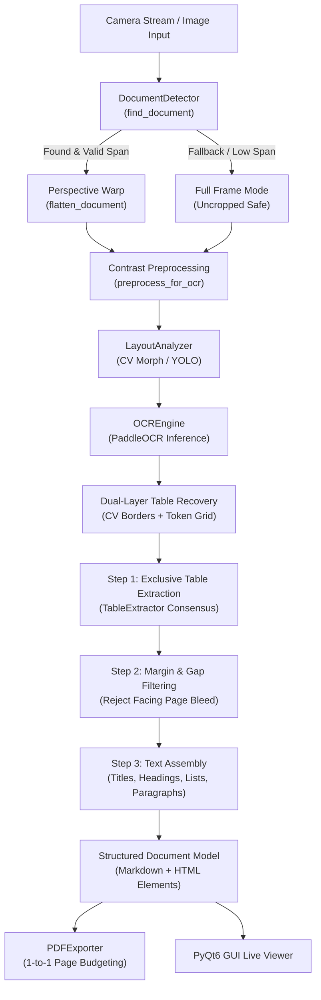
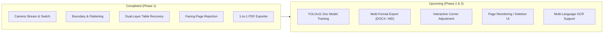

# LiveDoc — Engineering Status, Architecture & Team Roadmap

> **Author**: Core Development Team  
> **Last Updated**: November 1, 2026  
> **Status**: Production-Ready Base / Pre-Release Testing  
> **Test Suite**: 24/24 Checks Passing (`python test_pipeline.py`)

---

## 1. Executive Summary & Objective

**LiveDoc** is a real-time, domain-agnostic intelligent document digitizer built using **PyQt6**, **OpenCV**, and **PaddleOCR**. It bridges the gap between raw camera image acquisition and publication-grade digitized output (Markdown, HTML, and multi-page vector-rendered PDF).

Unlike naive OCR tools that dump text as unstructured word clouds, LiveDoc preserves the authentic 2D semantic structure of physical pages:
- **Hierarchical Headings & Titles** (Running headers, sections, sub-sections)
- **Compact 2D Tabular Matrices** (Multi-column truth tables, numeric grids)
- **Continuous Flowing Paragraphs** (Joining wrapped sentences while isolating list items)
- **Strict Page-to-Page Correspondence** (1 scanned page = exactly 1 PDF page)

---

## 2. Current Project Status (How Much Work Is Done)

### ✅ Completed Modules & Subsystems

| Subsystem | File | Status | Key Capabilities |
|---|---|---|---|
| **Camera Manager** | [`src/camera_manager.py`](file:///Users/viraj/Desktop/LiveDoc/src/camera_manager.py) | **100% Done** | Live capture, device enumeration, runtime camera index switching, clean thread safety. |
| **Document Detector** | [`src/document_detector.py`](file:///Users/viraj/Desktop/LiveDoc/src/document_detector.py) | **100% Done** | Blur/glare scoring, 4-corner polygon detection, aspect-ratio validation ($1.05 \le \text{ratio} \le 2.2$), full-span bounding checks ($\ge 55\%$ width/height), safe full-frame fallback, perspective flattening. |
| **Layout Analyzer** | [`src/layout_analyzer.py`](file:///Users/viraj/Desktop/LiveDoc/src/layout_analyzer.py) | **100% Done** | Dual-mode: YOLOv11 deep layout detector with automated fallback to high-precision OpenCV morphological table/text line analyzer. |
| **OCR Engine** | [`src/ocr_engine.py`](file:///Users/viraj/Desktop/LiveDoc/src/ocr_engine.py) | **100% Done** | PaddleOCR integration, token coordinate parsing, dual-layer table recovery (grid clustering), facing-page/margin bleed rejection, outline heading detection, sequential bullet normalization. |
| **Table Extractor** | [`src/table_extractor.py`](file:///Users/viraj/Desktop/LiveDoc/src/table_extractor.py) | **100% Done** | Multi-row column consensus voting, horizontal cluster density estimation, stray stopword row filtering, footnote digit stripping, centered Markdown & publication HTML generation. |
| **PDF Exporter** | [`src/pdf_exporter.py`](file:///Users/viraj/Desktop/LiveDoc/src/pdf_exporter.py) | **100% Done** | Multi-page PDF generation via Qt paint engine, strict single-page budgeting, dynamic typography scaling (8.5pt–10.5pt), running headers, zero cross-page table splits. |
| **User Interface** | [`src/gui.py`](file:///Users/viraj/Desktop/LiveDoc/src/gui.py) | **100% Done** | Dark-themed PyQt6 dashboard, live viewfinder with real-time status badges, camera rotation, multi-page history drawer, Markdown/HTML preview tabs, PDF export action. |
| **Pipeline Test Suite** | [`test_pipeline.py`](file:///Users/viraj/Desktop/LiveDoc/test_pipeline.py) | **100% Done** | 24 automated unit and integration tests verifying imports, camera capture, boundary detection, layout extraction, OCR parsing, and PDF compilation. |

---

## 3. Architecture & Processing Pipeline

The pipeline follows a strict, one-way deterministic flow:



### Detailed Pipeline Stages:

1. **Boundary & Quality Assessment** ([`src/document_detector.py`](file:///Users/viraj/Desktop/LiveDoc/src/document_detector.py)):
   - Checks Laplacian variance for blur (`threshold=15`) and pixel saturation for glare.
   - Detects external quadrilateral contours with area $\ge 45\%$ of frame and spanning $\ge 55\%$ of frame dimensions.
   - If contours fail aspect ratio ($1.05 \le \text{ratio} \le 2.2$) or span checks, safely falls back to full-frame mode to guarantee zero text amputation.
2. **Layout & Feature Detection** ([`src/layout_analyzer.py`](file:///Users/viraj/Desktop/LiveDoc/src/layout_analyzer.py)):
   - Uses morphological kernel analysis (`cv2.morphologyEx`) with horizontal and vertical kernels to detect table borders and text bands.
3. **Structured OCR Engine** ([`src/ocr_engine.py`](file:///Users/viraj/Desktop/LiveDoc/src/ocr_engine.py)):
   - Runs PaddleOCR inference with auto-rotation detection.
   - Performs dual-layer table recovery: if CV borders miss a faint table, proximity clustering on tabular tokens recovers the 2D grid.
   - Enforces strict horizontal reading gap limits ($\le 75\text{px}$) to isolate facing-page margin words from merging into active lines.
   - Assembles flowing sentences while isolating list items (`1.`, `i)`, `(a)`) and labeled definitions (`Example:`, `Solution:`).
4. **Table Reconstruction** ([`src/table_extractor.py`](file:///Users/viraj/Desktop/LiveDoc/src/table_extractor.py)):
   - Calculates density-based column centers across all rows.
   - Purges phantom columns (requiring $\ge 40\%$ row consensus) and removes stray rows containing prose stopwords.
5. **Vector PDF Export** ([`src/pdf_exporter.py`](file:///Users/viraj/Desktop/LiveDoc/src/pdf_exporter.py)):
   - Renders cleanly formatted A4 pages with running headers, centered compact tables, and dynamic font budgeting.

---

## 4. Mandatory Engineering Rules (For All Team Members)

To keep the codebase maintainable and robust, **all team members must strictly obey these core principles**:

### Rule 1: ZERO HARDCODING
- **NEVER** write book-specific text overrides (e.g. `if "Theory of Computation" in text:` or `if "Symmetric" in line:`).
- All classification and formatting must be derived from **universal geometric, statistical, or regex properties**:
  - Headings are detected by font size, uppercase casing, Roman numerals (`i)`, `iv)`), or section patterns (`1.5`).
  - Tables are detected by grid morphology and column coordinate clustering.
  - Bullets are detected by standard numerical/alphabetical list patterns.

### Rule 2: Protect Against Facing-Page & Margin Bleed
- When scanning an open book, words from the adjacent facing page appear at the extreme margins ($X > 82\%$ or $X < 8\%$).
- **Never** merge tokens across a gap $> 75\text{px}$ on the horizontal axis into the same line.
- Discard isolated single-token lines located in outer margin zones.

### Rule 3: Never Amputate Text with Over-Aggressive Cropping
- Partial crops destroy OCR accuracy. An auto-cropper must require at least $45\%$ frame area and $\ge 55\%$ width/height span.
- When in doubt, falling back to full frame is infinitely better than cutting off 30% of the page.

### Rule 4: Table Grid Consensus Over Loose Text
- Tables must be extracted compactly (~80px height).
- Never allow prose fragments (`The truth table for...`) into table header bounding boxes.

### Rule 5: 1-to-1 Page Budgeting
- A single scanned document page must produce exactly one page in the exported PDF.
- The height budget is $\approx 720\text{px}$. Tables must use compact cell padding (2px–2.5px), and fonts dynamically scale from 10.5pt down to 8.5pt when content is dense.

---

## 5. Development Roadmap & Next Steps

The next phase of development focuses on high-value feature enhancements:



### Team Task Assignments / Backlog:

1. **YOLOv11 Model Integration** (`models/yolo11_doc.pt`):
   - Train or bundle a lightweight YOLOv11 document layout checkpoint (`yolo11n-doc.pt`) for ultra-fast GPU/Neural Engine layout tagging.
   - Keep CV morphological analyzer active as an automated fallback.
2. **Multi-Format Export**:
   - Add `.docx` (Microsoft Word) export alongside PDF and Markdown using `python-docx`.
   - Add plain Markdown / ZIP bundle export with saved crop images.
3. **Interactive Manual Crop Adjustment (GUI)**:
   - When a user pauses or freezes a frame, allow dragging the 4 corner handles on the screen before confirming the scan.
4. **Scanned Page Management**:
   - Add "Delete Page", "Re-order Pages" (drag & drop), and "Re-scan Page" buttons in the left history drawer.
5. **Multi-Language OCR Toggle**:
   - Expose language selection in the GUI settings (`en`, `hi`, `fr`, `de`, `es`, `zh`) to leverage PaddleOCR's multi-lingual weights.

---

## 6. How to Run, Test, and Verify Locally

### Environment Setup
```bash
# Activate your conda or virtual environment (Python 3.10 recommended)
conda activate livedoc
# or: source venv/bin/activate

# Install dependencies (if setting up fresh)
pip install -r requirements.txt
```

### Running the Test Suite
```bash
# Run full automated integration tests (all 24 checks must pass)
python test_pipeline.py
```

### Launching the Application
```bash
# Launch the PyQt6 graphical application
python src/main.py
```

### Running Multi-Page Verification Script
```bash
# Validate multi-page scanning on test images and export verification PDF
python scratch/run_full_validation_v11.py
```
