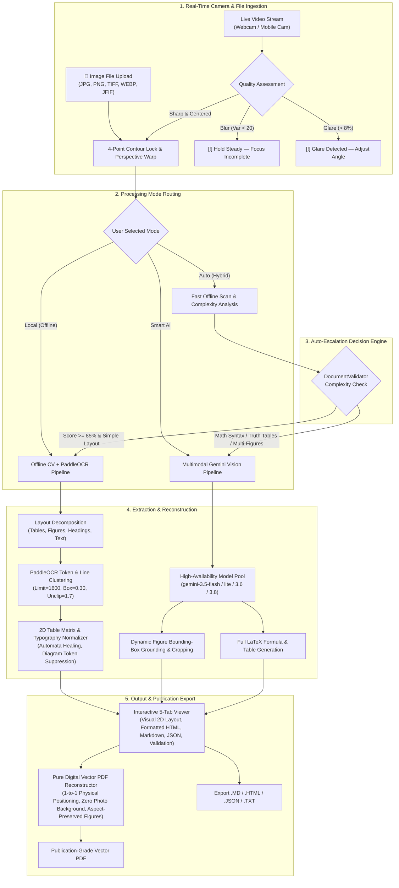
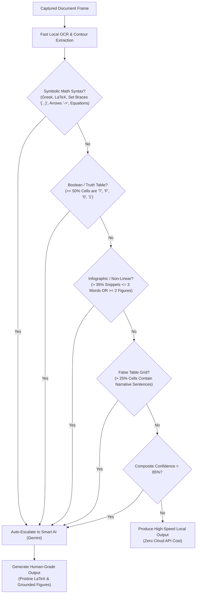
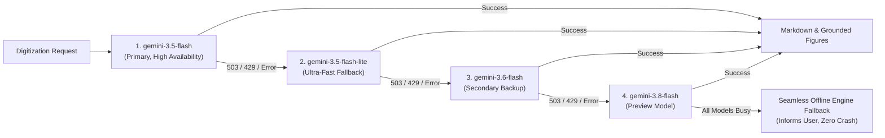
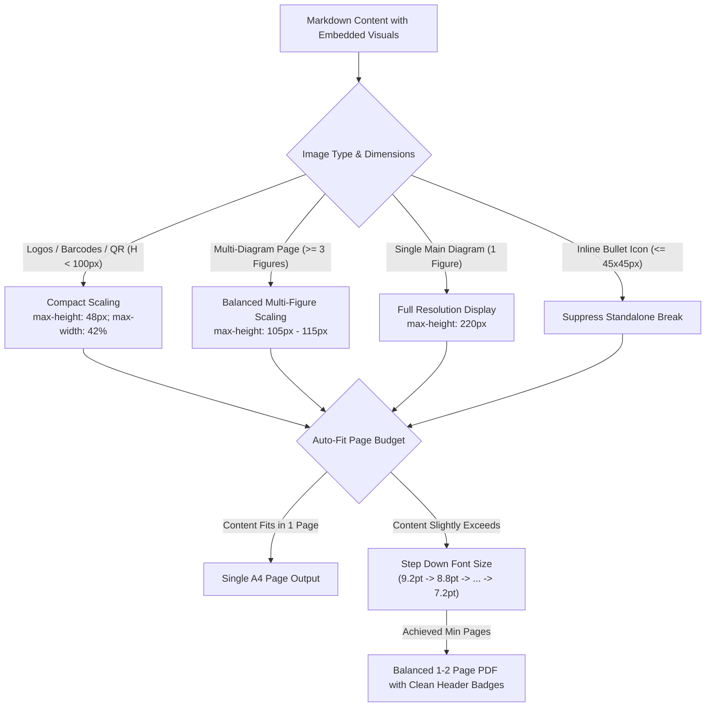

# LiveDoc: Real-Time Intelligent Document Digitizer

**LiveDoc** is an advanced, domain-agnostic document digitization and structural understanding platform powered by Computer Vision, Deep Learning Layout Analysis, PaddleOCR, Multimodal Vision AI (Google Gemini), and Rule-Based Integrity Validation.

Unlike traditional flatbed scanners or mobile camera apps that merely save static images or PDFs, **LiveDoc actively deconstructs physical documents into native digital components** (Titles, Headings, Flowing Paragraphs, Clean Lists, Pristine LaTeX Equations, and Reconstructed Data Tables) while preserving authentic vertical reading flow and publication-grade typography.

---

## Tri-Mode Processing Architecture

LiveDoc features a versatile tri-mode processing engine that balances speed, privacy, and digitization fidelity:

```
┌────────────────────────────────────────────────────────────────────────┐
│                        LiveDoc Processing Modes                        │
├────────────────────┬─────────────────────────────┬─────────────────────┤
│ 🖥️  Local (Offline) │ ⚡ Auto (Hybrid Escalation)  │ 🌟 Smart AI (Gemini)│
├────────────────────┼─────────────────────────────┼─────────────────────┤
│ • 100% Offline     │ • Instant Offline Scan      │ • Multimodal Vision │
│ • Zero API costs   │ • Structural Complexity Eva │ • 100% Clean Text   │
│ • Fast OCR & Grid  │ • Auto-Escalates on Math /  │ • Full LaTeX Math   │
│ • Complete Privacy │   Complex Grids / Diagrams  │ • Figure Grounding  │
└────────────────────┴─────────────────────────────┴─────────────────────┘
```

1. **🖥️ Local (Offline Mode)**:
   - Operates 100% locally on your CPU/GPU with zero internet connection or API keys required.
   - **Adaptive Contrast Equalization**: Integrates CLAHE (`clipLimit=1.6`, tile size `8x8`) to eliminate camera shadows and enhance faint text and thin line strokes.
   - **High-Precision OCR**: Upgraded PaddleOCR parameters (`det_limit_side_len=1600`, `det_db_box_thresh=0.30`, `det_db_unclip_ratio=1.7`) for superior recognition of fine indices, Greek symbols, and transition arrows.
   - **Intelligent Diagram Segmentation**: Uses a `(17, 17)` morphological bridge kernel and `cv2.RETR_LIST` with border clearing to accurately detect, crop, and caption state diagrams, flowcharts, circuits, and illustrations (`documents/figures/`).
   - **Automata & Mathematical Healing**: Automatically reconstructs automata state indices (`q₀`, `q₁`, `qₙ`), input/output symbols (`a₀`, `b₁`), Greek mappings ($\delta$, $\lambda$), and transition arrows (`→`).
   - **Table Extraction & Safeguards**: Recovers 2D table matrices while strictly preventing diagrams or captions from being misclassified as tables.
   - Ideal for standard reports, textbooks, technical diagrams, printed invoices, receipts, and confidentiality-restricted documents.

2. **🌟 Smart AI Mode (Multimodal Vision)**:
   - Powered by Google Gemini multimodal vision AI through a high-availability model fallback pool (`gemini-3.5-flash`, `gemini-3.5-flash-lite`, `gemini-3.6-flash`, `gemini-3.8-flash`).
   - Delivers human-grade digitization with zero character noise.
   - Automatically preserves mathematical equations in standard LaTeX (`$...$` and `$$...$$`).
   - Grounds and crops real high-resolution diagrams, figures, and visual charts directly from the physical capture.
   - Resilient against server spikes (automatic failover on HTTP 503 / 429).

3. **⚡ Auto (Hybrid Escalation Mode - Default)**:
   - The best of both worlds: initiates a fast local scan, runs real-time structural analysis via `DocumentValidator`, and checks document complexity.
   - **Automatic Escalation Triggers**:
     - Formal mathematical, algebraic, or logic syntax (set braces `{...}`, implication arrows `->`, Greek letters, equations).
     - Boolean truth tables or binary state matrices ($> 50\%$ single-character truth values).
     - Multi-figure or complex non-linear spatial layouts ($> 35\%$ short fragmented snippets or $\ge 2$ figures).
     - False/distorted tables with narrative sentences inside grid cells.
   - When complexity is detected, LiveDoc automatically escalates the scan to Smart AI for human-grade output.

---

## End-to-End System Workflow



---

## Detailed Pipeline Flowcharts

### 1. Auto-Mode Decision & Escalation Flowchart

Auto Mode balances execution speed, zero unnecessary API usage, and digitization accuracy through multi-metric complexity scoring:



---

### 2. Smart AI Multi-Model Resilience & Fallback Flowchart

LiveDoc guarantees continuous service availability even during Google Cloud traffic spikes:



---

### 3. Proportional Figure Sizing & PDF Auto-Fit Flowchart

LiveDoc sizes figures dynamically and adjusts font sizes so each scanned page forms a self-contained, publication-ready PDF page without table splitting:



---

## Core Pipeline Capabilities

### 1. Camera & Positioning Guidance (`src/camera_manager.py`, `src/document_detector.py`)
- Background capture thread eliminating UI freezes.
- Auto-detects 1080p/720p hardware resolutions (supports physical webcams and phone cameras via Iriun/DroidCam).
- Real-time quality evaluation:
  - **Sharpness/Blur check** via downscaled Laplacian variance ($> 20.0$).
  - **Glare assessment** monitoring saturated pixel ratios ($> 8\%$).
  - **Centering & Proximity advice** alerting users if the document is too far or off-center.
- 4-point convex hull detection with perspective transform to flatten skewed captures into crisp top-down scans.
- ASCII-safe video overlay HUD (`[OK]`, `[!]`) ensuring clean rendering across all camera drivers.

### 2. High-Precision Layout Decomposition (`src/layout_analyzer.py`)
- Morphological horizontal and vertical projection kernels to isolate table borders, horizontal rules, and distinct content sections.
- Universal table grid validation requiring intersecting cell junctions, preventing page-spanning borders or underlines from being misidentified as tables.
- Dual-engine architecture: uses custom YOLO models (`models/yolo11_doc.pt`) when weights are present, seamlessly falling back to morphological CV analysis.

### 3. Universal Typography & LaTeX Engine (`src/pdf_exporter.py`)
- Transforms raw LaTeX formulas into publication-grade typography:
  - **Greek Letters**: $\alpha, \beta, \gamma, \delta, \lambda, \sigma, \theta, \omega, \mu, \pi, \dots$
  - **Logic Operators**: $\land, \lor, \neg, \sim, \to, \implies, \leftrightarrow$
  - **Set & Relational Notation**: $\in, \notin, \subset, \subseteq, \cup, \cap, \emptyset, \{a, b\}$
  - **Calculus & Operators**: $\sum, \int, \partial, \infty, \pm, \le, \ge, \neq, \approx$
  - **Subscripts / Superscripts**: `q_0` $\to$ `q<sub>0</sub>`, `x^2` $\to$ `x<sup>2</sup>`
  - **Labeled Transition Arrows**: `\xrightarrow{a}` $\to$ `―a→`
  - **Overlines**: `\bar{S}` $\to$ `S̄`
  - **Typographic Bullets**: `* item` $\to$ `• item`

### 4. Dynamic Proportional Image & Figure Sizing (`src/pdf_exporter.py`, `src/smart_ai_engine.py`)
- Multimodal AI extracts bounding boxes `[ymin, xmin, ymax, xmax]` and crops physical diagrams directly from the scan.
- **Intelligent Proportional Scaling**:
  - **Logos, barcodes, and QR codes**: Sized to compact dimensions (`max-height: 48px; max-width: 42%`).
  - **Multi-image diagrams**: Scaled to balanced proportions (`max-height: 105px–115px`).
  - **Single main figures**: Preserved at full resolution (`max-height: 220px`).
  - **Micro-bullet icons**: Suppressed from creating standalone page breaks.

### 5. Auto-Fit PDF Pagination (`src/pdf_exporter.py`)
- Intelligent multi-tier font auto-fitting ensures that single scanned pages form authentic, self-contained single PDF pages without table splitting or unnatural page breaks.
- Multi-page documents are structured with clean running headers and page numbers.

### 6. Validation & Integrity Engine (`src/validator.py`)
- **Principle**: Extract $\rightarrow$ Validate $\rightarrow$ Flag $\rightarrow$ Preserve Original $\rightarrow$ Report.
- Never silently mutates or guesses uncertain characters.
- Detects false tables (long sentences in cells) and flags them for verification.
- Runs row-level arithmetic checks ($Qty \times Unit\ Price == Total$) and grand total column sums on tabular financial documents.

---

## Directory Structure

```
LiveDoc/
├── main.py                     # Application Entrypoint
├── test_pipeline.py            # Comprehensive 24-point validation test suite
├── train_layout_model.py       # Training pipeline for DocLayNet / YOLO11 doc models
├── requirements.txt            # Python dependencies
├── README.md                   # System documentation
├── src/
│   ├── __init__.py
│   ├── camera_manager.py       # Threaded multi-resolution camera ingestion
│   ├── document_detector.py    # Edge detection, quality checks & perspective warp
│   ├── layout_analyzer.py      # Bounding box layout decomposition
│   ├── ocr_engine.py           # PaddleOCR extraction, diagram segmentation & automata healing
│   ├── layout_renderer.py      # Unified 2D visual layout & digital vector PDF renderer
│   ├── text_markup.py          # Typography sanitizer, LaTeX entity converter & symbol scrubber
│   ├── smart_ai_engine.py      # Google Gemini multimodal vision AI with fallback pool
│   ├── table_extractor.py      # Matrix cell clustering & table reconstruction
│   ├── validator.py            # Confidence auditing & intelligent auto escalation
│   ├── pdf_exporter.py         # Digital vector PDF reconstruction & physical coordinate mapping
│   └── gui.py                  # PyQt6 dark-themed interface + Image Upload & 5-tab preview
├── documents/
│   └── figures/                # Grounded, high-resolution diagram & figure crops
└── models/                     # Custom trained YOLO weights (gitignored)
```

---

## Installation & Setup

### Prerequisites
- macOS, Linux, or Windows
- Python 3.10 or 3.11 (Conda recommended)
- Webcam, laptop camera, or mobile camera via Iriun Webcam / DroidCam

### 1. Environment Setup
```bash
# Clone the repository
git clone -b Viraj https://github.com/PRAJAPATI-NEEL-2005/LiveDoc.git
cd LiveDoc

# Create and activate conda environment
conda create -n livedoc python=3.10 -y
conda activate livedoc

# Install dependencies
pip install -r requirements.txt
```

### 2. Verify Installation
Run the complete 24-point integration test suite:
```bash
python test_pipeline.py
```
Expected output:
```text
============================================================
  SUMMARY
============================================================

  24/24 checks passed

  ✅ OpenCV
  ✅ NumPy
  ✅ PyQt6
  ✅ Ultralytics (YOLO)
  ✅ PaddleOCR
  ✅ LiveCameraManager import
  ✅ Camera open (webcam found)
  ✅ get_frame() returns image
  ✅ camera.release()
  ✅ DocumentDetector import
  ✅ is_blurry() on sharp image
  ✅ is_blurry() on blurry image
  ✅ find_document() on synthetic doc
  ✅ flatten_document() perspective warp
  ✅ LayoutAnalyzer import
  ✅ LayoutAnalyzer init (fallback mode)
  ✅ analyze() returns layout boxes
  ✅ OCREngine import
  ✅ OCREngine init (PaddleOCR ready)
  ✅ extract_full_text() reads text from image
  ✅ extract_from_boxes() structured output
  ✅ Full pipeline: synthetic doc → extracted text
  ✅ PDFExporter import
  ✅ markdown_to_pdf() generates valid multi-page PDF

============================================================
```

### 3. Launch LiveDoc
```bash
python main.py
```

---

## Usage Guide

1. **Document Ingestion (Camera or Image Upload)**:
   - **Live Camera**: Choose your webcam or connected phone camera from the dropdown in the toolbar. Place your document within view until the green boundary locks. Click **Scan Document**.
   - **Image File Upload**: Click the purple **📂 Upload Image** button in the toolbar. Select any `.jpg`, `.jpeg`, `.png`, `.bmp`, `.tiff`, `.webp`, or `.jfif` file. LiveDoc immediately displays the preview badge and automatically executes full digitization into all output tabs.
2. **Choose Mode**:
   - **Auto (Hybrid)** *(Recommended)*: Fast offline scan that automatically enhances complex layouts with Smart AI.
   - **Smart AI (Gemini)**: Full multimodal vision digitization for publication-grade output with LaTeX equations.
   - **Local (Offline)**: 100% offline, zero-network processing with intelligent diagram segmentation and automata healing.
3. **Configure Gemini API Key** *(Optional, for Smart AI / Auto)*:
   - Click **⚙️ AI Settings** in the toolbar.
   - Enter your free Gemini API key from [Google AI Studio](https://aistudio.google.com).
   - Click **Test Connection** $\rightarrow$ **Save API Key**.
4. **Interactive 5-Tab Review**:
   - **Visual 2D Layout**: Interactive vector-rendered page matching the exact physical layout with proportional diagrams, centered tables, and clean typography.
   - **Formatted Document**: Rich visual HTML preview with rendered tables, diagrams, and styled typography.
   - **Markdown / Plain Text**: Clean GitHub-Flavored Markdown with standard LaTeX math.
   - **Structured JSON**: Machine-readable tokens, coordinates, bounding boxes, and hierarchy.
   - **Validation Report**: Real-time confidence score (OCR, Lexical, Table, Layout) and arithmetic auditing.
5. **Export**:
   - Click **📄 Save as PDF** to export a pure digital vector PDF (with 1-to-1 physical positioning, zero scanned photo background, and aspect-preserved figures).
   - Click **Export Document...** to save as `.md`, `.html`, `.json`, or `.txt`.
